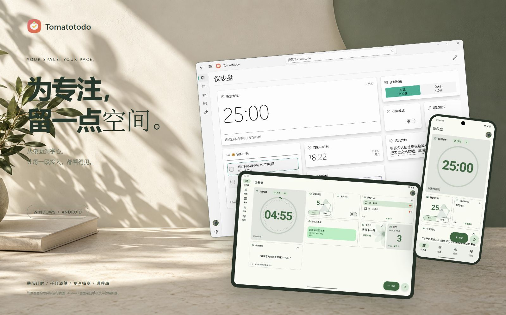
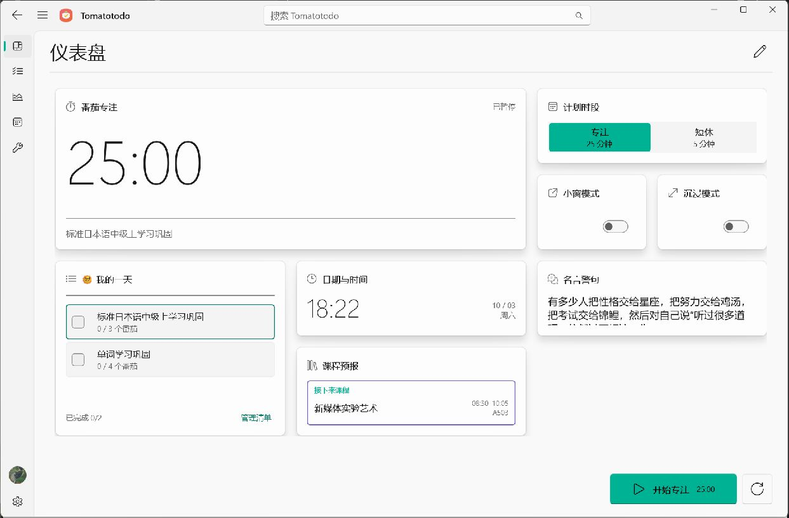
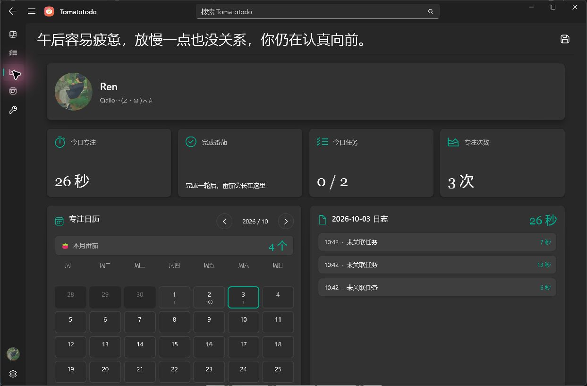
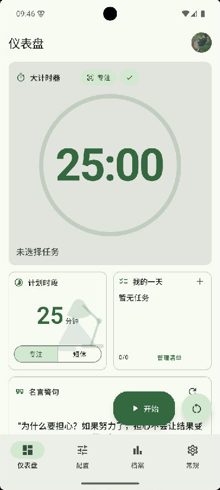
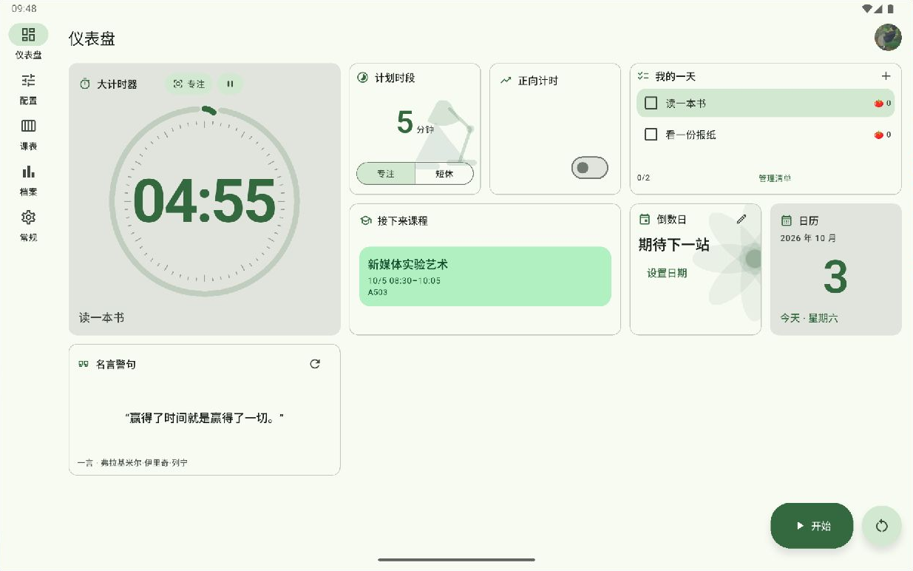
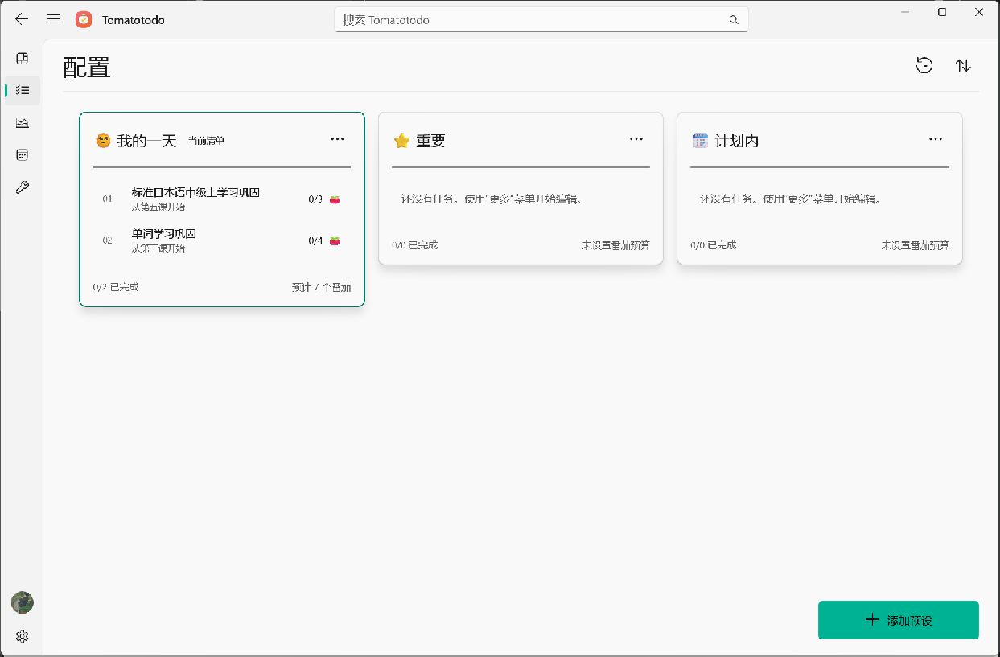
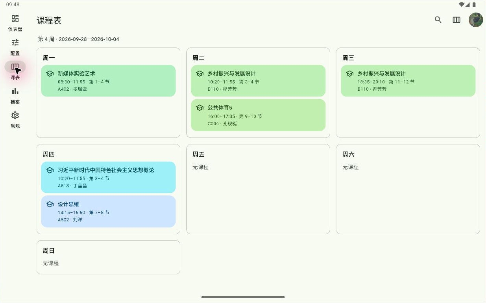
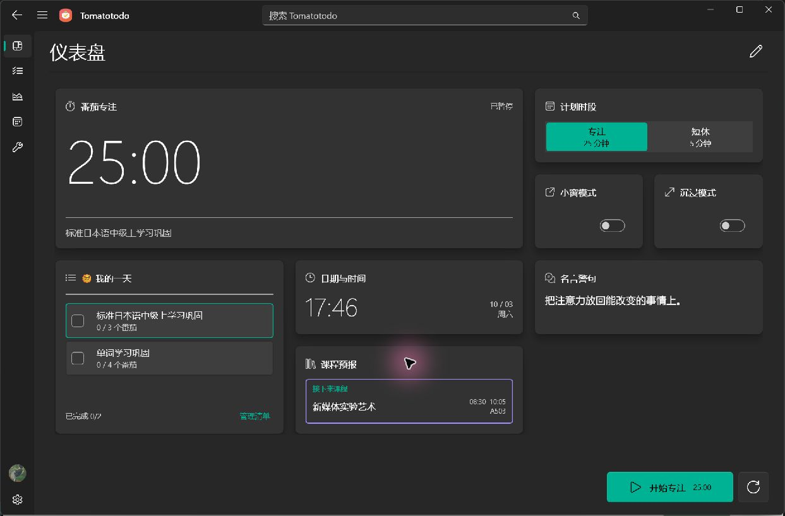
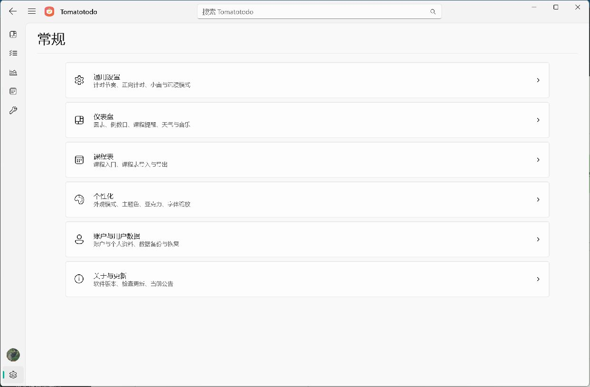

<p align="right">
  <strong>EN</strong> | <a href="./docs/README.zh-CN.md">CN</a> | <a href="./docs/README.ja.md">JA</a>
</p>

<div align="center">
  
  <h1>Tomatotodo</h1>
</div>

<p align="center">
  <em>Pomodoro timing, task lists, and focus history for Windows and Android.</em>
</p>

<p align="center">
    <a href="https://github.com/GreentailTohru-arch/Tomatotodo/releases/latest"></a>
    <a href="https://github.com/GreentailTohru-arch/Tomatotodo/releases/download/v1.6.2/Tomatotodo-Setup-1.6.2.exe"></a>
    <a href="https://github.com/GreentailTohru-arch/Tomatotodo/releases/download/android-v1.0.3/Tomatotodo-1.0.3.apk"></a>
    <a href="./LICENSE"></a>
</p>

<div align="center">
  <a href="https://greentailtohru-arch.github.io/Tomatotodo/"></a>
</div>

## What is Tomatotodo?

Tomatotodo brings task planning, focus sessions, and time tracking into one app. Pick a task, start a timer, and use the focus archive to review where your time went. The Windows and Android clients can be used locally or connected to the same cloud account.

## Supported platforms

| Platform | System requirements | Release notes |
| --- | --- | --- |
| Windows | Windows 10 version 2004 or later (including Windows 11), x64 | [1.6.2](https://github.com/GreentailTohru-arch/Tomatotodo/releases/tag/v1.6.2) |
| Android | Android 7.0 or later; arm64-v8a, armeabi-v7a, x86_64 | [1.0.3](https://github.com/GreentailTohru-arch/Tomatotodo/releases/tag/android-v1.0.3) |

## Showcase

### On your desktop

<table>
  <tr>
    <td width="50%" align="center"><br><sub><b>Windows dashboard</b></sub></td>
    <td width="50%" align="center"><br><sub><b>Windows focus archive</b></sub></td>
  </tr>
</table>

### On phones and tablets

<table>
  <tr>
    <td width="30%" align="center"><br><sub><b>Android phone dashboard</b></sub></td>
    <td width="70%" align="center"><br><sub><b>Android tablet dashboard</b></sub></td>
  </tr>
</table>

<details>
<summary>More views — tasks, courses, and appearance</summary>

<table>
  <tr>
    <td width="50%" align="center"><br><sub><b>Windows task lists</b></sub></td>
    <td width="50%" align="center"><br><sub><b>Android tablet timetable</b></sub></td>
  </tr>
  <tr>
    <td width="50%" align="center"><br><sub><b>Windows dark theme</b></sub></td>
    <td width="50%" align="center"><br><sub><b>Windows settings</b></sub></td>
  </tr>
</table>

</details>

The screenshots show the installed Windows client and the Android client running in phone and tablet emulators.

## Quick install

- **Windows**: [Download EXE](https://github.com/GreentailTohru-arch/Tomatotodo/releases/download/v1.6.2/Tomatotodo-Setup-1.6.2.exe)
- **Android**: [Download APK](https://github.com/GreentailTohru-arch/Tomatotodo/releases/download/android-v1.0.3/Tomatotodo-1.0.3.apk)

## Features

### Focus and tasks

- Set focus and short-break durations; choose manual or automatic cycling, or count up from zero.
- Manage task lists, reorder tasks, set Pomodoro estimates, and track completion.

### History and timetable

- Review daily logs, day/week/month/year statistics, and the annual focus heatmap.
- View the weekly timetable, set course reminders, and import or export timetable JSON independently.

### Interface and widgets

- Arrange dashboard widgets and choose light, dark, or automatic appearance. The interface can follow the system language.
- Windows includes a floating timer and system tray controls. Android supports resizable dashboard cards and home screen widgets.

## Installation

On Windows, run the EXE and follow the setup wizard. On Android, open the APK and follow the system prompts. The published APK is signed with the project's debug certificate. Export a JSON backup before upgrading.

### First run

1. Create a list and add a task in the task configuration page.
2. Choose the task on the dashboard and start the timer. Set the focus and break durations in Settings.
3. Open the focus archive to review the session.

## Multi-device sync

Sign in to the same cloud account on both devices to sync task lists, timetable data, timer settings, and focus logs. Use the in-app migration option to bring existing local data into the cloud account. When both devices change the same data section, follow the conflict prompt. [Sync protocol](./windows/docs/cross-platform-sync-v2.md)

## App data and privacy

Core features are available without an account. You can export user data as JSON for backup or migration. Active timer progress stays on the device; dashboard layouts and appearance settings are maintained separately for each platform. The cloud service is maintained separately from this repository.

## Build from source

| Path | Contents | Documentation |
| --- | --- | --- |
| [`windows/`](./windows/) | C# / .NET 10 / WinUI 3 client | [Windows development](./windows/README.md) |
| [`android/`](./android/) | Flutter / Dart / Kotlin client | [Android development](./android/README.md) |
| [`Website/`](./Website/) | Static website and screenshots | [Website deployment](./Website/README.md) |
| [`docs/archive/`](./docs/archive/) | Historical identification materials for version 1.3.0 | — |

### Windows

Install the .NET 10 SDK, Windows SDK, and Visual Studio WinUI tools.

```powershell
cd windows
dotnet restore Tomatotodo.Windows.csproj
dotnet build Tomatotodo.Windows.csproj -p:Platform=x64
dotnet run --project tests/CourseSchedule.Tests.csproj
dotnet run --project tools/Sync.Tests/Sync.Tests.csproj
```

### Android

Install Flutter, the Android SDK, and JDK 17. See the Dart constraint in [`pubspec.yaml`](./android/pubspec.yaml)

```bash
cd android
flutter pub get
flutter analyze
flutter test
flutter build apk --release
```

## Contributing

[GitHub Issues](https://github.com/GreentailTohru-arch/Tomatotodo/issues) — Report bugs or suggest changes in GitHub Issues. Include the platform, app version, reproduction steps, and expected and actual results. Remove personal data from logs and screenshots.

## License

[MIT](./LICENSE) · Distributed under the MIT License.
