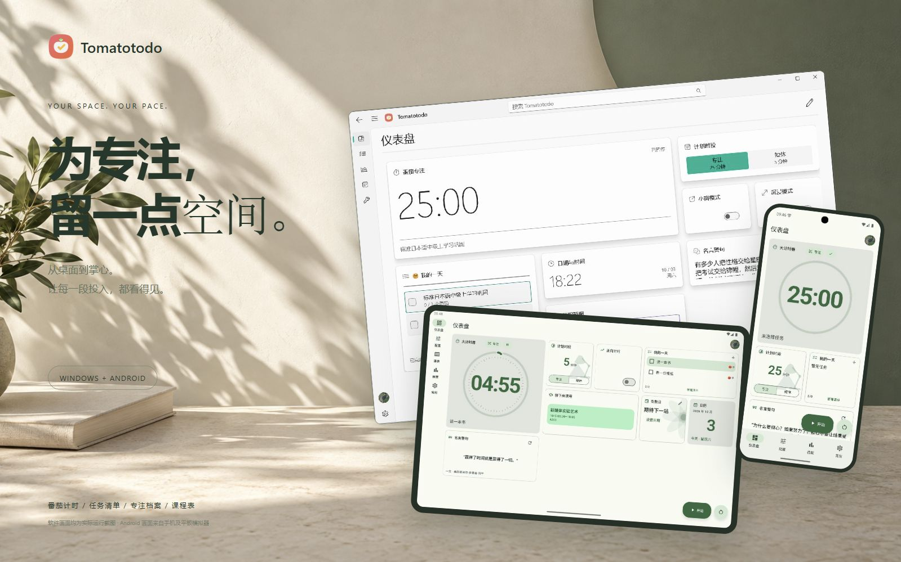
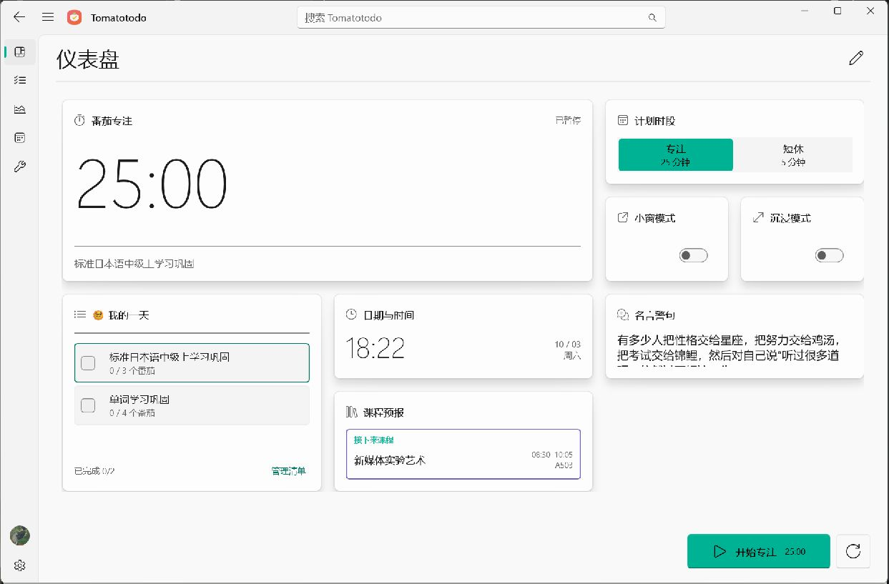
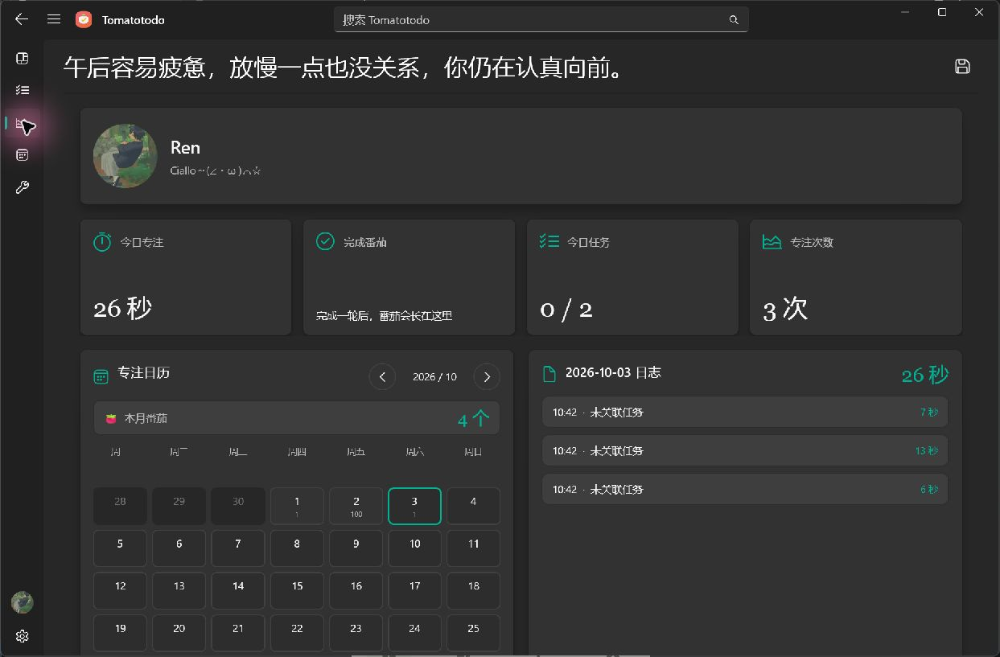
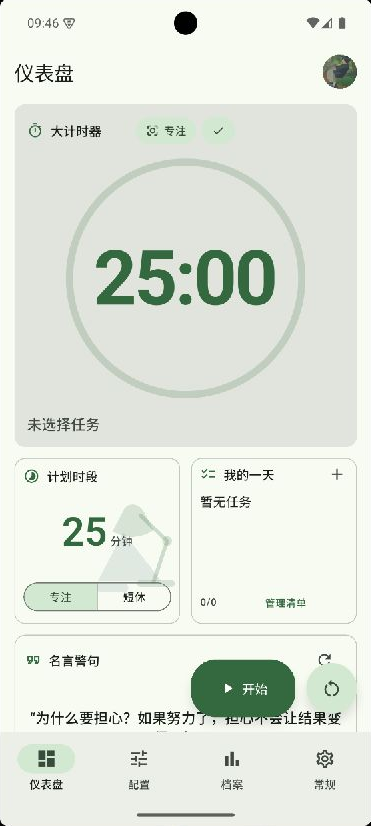
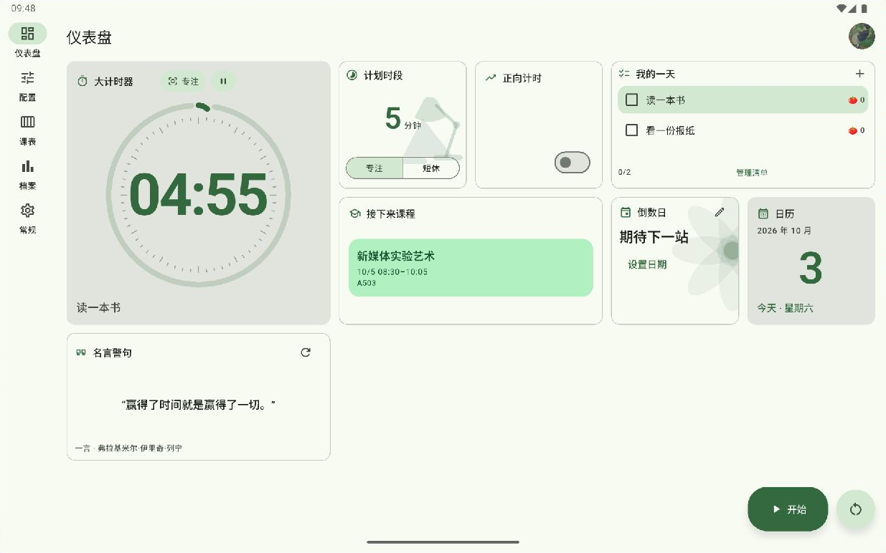
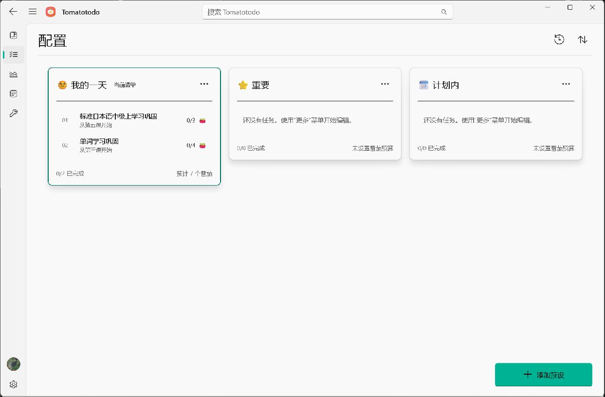
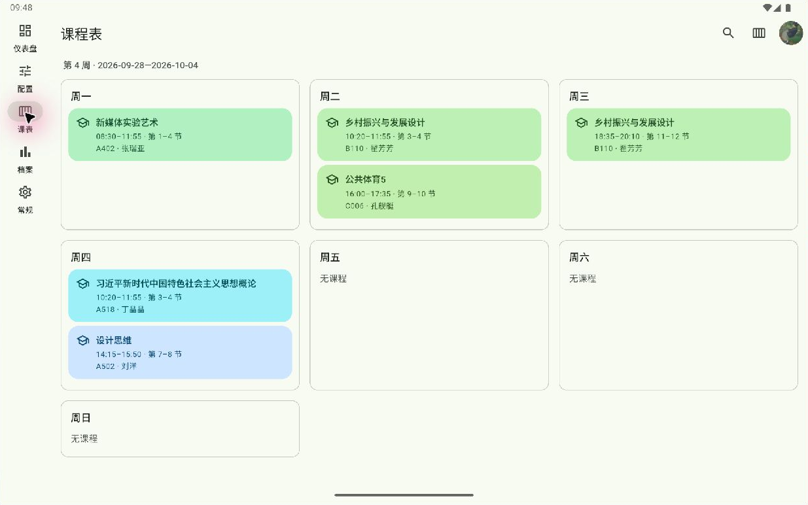
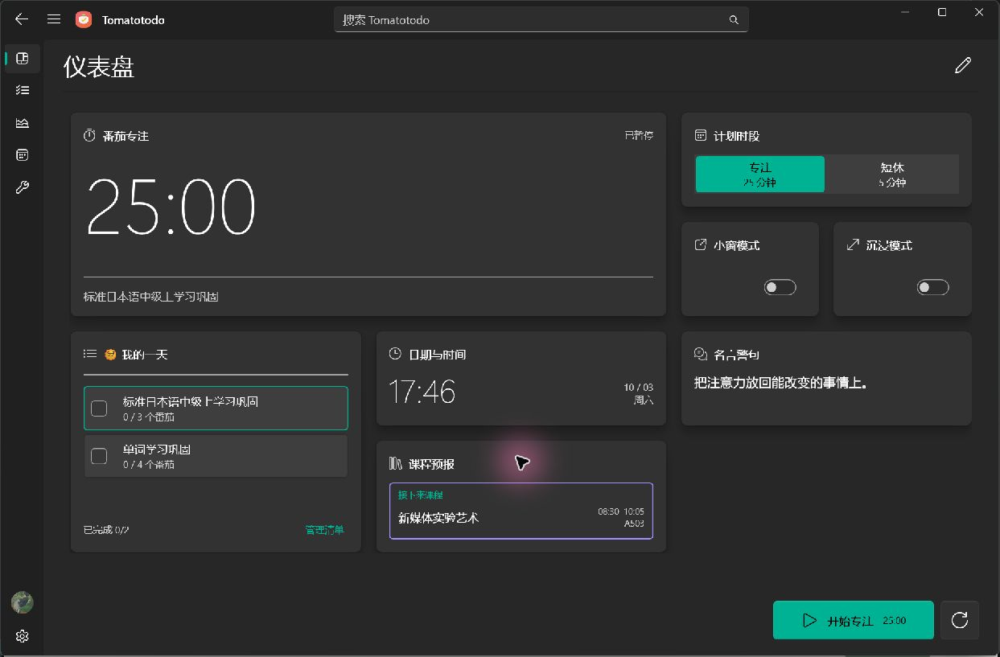
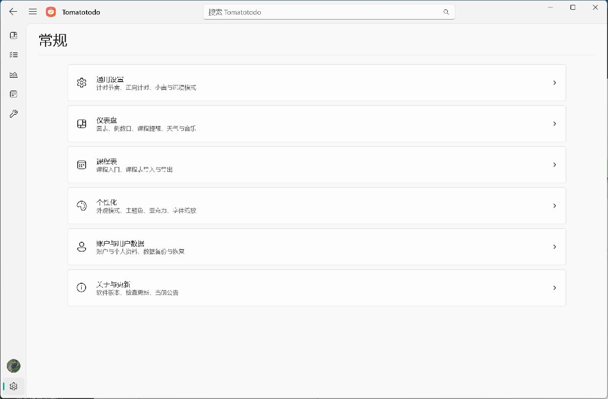

<p align="right">
  <a href="../README.md">EN</a> | <a href="./README.zh-CN.md">CN</a> | <strong>JA</strong>
</p>

<div align="center">
  
  <h1>Tomatotodo</h1>
</div>

<p align="center">
  <em>Windows と Android 向けのポモドーロタイマー、タスクリスト、集中時間の記録アプリ。</em>
</p>

<p align="center">
    <a href="https://github.com/GreentailTohru-arch/Tomatotodo/releases/tag/v1.6.2"></a>
    <a href="https://github.com/GreentailTohru-arch/Tomatotodo/releases/tag/android-v1.0.3"></a>
    <a href="../LICENSE"></a>
</p>

<div align="center">
  <a href="https://greentailtohru-arch.github.io/Tomatotodo/"></a>
</div>

## Tomatotodo とは

Tomatotodo は、タスクの計画、集中タイマー、時間の記録をまとめたアプリです。タスクを選んで計測を始め、集中履歴で時間の使い方を振り返れます。Windows 版と Android 版は、端末内だけでも、同じクラウドアカウントに接続しても使えます。

## 対応プラットフォーム

| プラットフォーム | 動作環境 | リリースノート |
| --- | --- | --- |
| Windows | Windows 10 バージョン 2004 以降（Windows 11 を含む）、x64 | [1.6.2](https://github.com/GreentailTohru-arch/Tomatotodo/releases/tag/v1.6.2) |
| Android | Android 7.0 以降、arm64-v8a・armeabi-v7a・x86_64 | [1.0.3](https://github.com/GreentailTohru-arch/Tomatotodo/releases/tag/android-v1.0.3) |

## 画面紹介

### Windows デスクトップ

<table>
  <tr>
    <td width="50%" align="center"><br><sub><b>Windows のダッシュボード</b></sub></td>
    <td width="50%" align="center"><br><sub><b>Windows の集中履歴</b></sub></td>
  </tr>
</table>

### Android スマートフォンとタブレット

<table>
  <tr>
    <td width="30%" align="center"><br><sub><b>Android スマートフォンのダッシュボード</b></sub></td>
    <td width="70%" align="center"><br><sub><b>Android タブレットのダッシュボード</b></sub></td>
  </tr>
</table>

<details>
<summary>その他の画面：タスク、時間割、外観</summary>

<table>
  <tr>
    <td width="50%" align="center"><br><sub><b>Windows のタスクリスト</b></sub></td>
    <td width="50%" align="center"><br><sub><b>Android タブレットの時間割</b></sub></td>
  </tr>
  <tr>
    <td width="50%" align="center"><br><sub><b>Windows のダークテーマ</b></sub></td>
    <td width="50%" align="center"><br><sub><b>Windows の設定</b></sub></td>
  </tr>
</table>

</details>

画像は、インストール済みの Windows 版と、スマートフォンおよびタブレットのエミュレーターで動作中の Android 版を撮影したものです。

## ダウンロード

- **Windows**: [ダウンロード EXE](https://github.com/GreentailTohru-arch/Tomatotodo/releases/download/v1.6.2/Tomatotodo-Setup-1.6.2.exe)
- **Android**: [ダウンロード APK](https://github.com/GreentailTohru-arch/Tomatotodo/releases/download/android-v1.0.3/Tomatotodo-1.0.3.apk)

## 主な機能

### タイマーとタスク

- 集中時間と短い休憩の長さを設定し、手動・自動の繰り返しや、ゼロからのカウントアップを選べます。
- 複数のタスクリストを管理し、並べ替え、見積もりポモドーロ数の設定、進捗の確認ができます。

### 集中履歴と時間割

- 日ごとの記録、日・週・月・年単位の統計、年間ヒートマップを確認できます。
- 週単位で時間割を表示し、授業前の通知を設定できます。時間割は個別に JSON で入出力できます。

### 表示とウィジェット

- ダッシュボードのウィジェットを配置し、ライト、ダーク、自動の外観を選べます。表示言語はシステム設定に合わせられます。
- Windows 版にはフローティングタイマーとシステムトレイの操作があり、Android 版では一部のカードのサイズ変更とホーム画面ウィジェットに対応しています。

## インストール

Windows では EXE を実行し、セットアップウィザードに従います。Android では APK を開き、システムの案内に従います。公開 APK はプロジェクトのデバッグ証明書で署名されています。更新前に JSON のバックアップを作成してください。

### 初回の使い方

1. タスク設定画面でリストを作成し、タスクを追加します。
2. ダッシュボードでタスクを選び、タイマーを開始します。集中時間と休憩時間は設定画面で調整できます。
3. 集中履歴で今回の記録を確認します。

## 複数端末間の同期

両方の端末で同じクラウドアカウントにログインすると、タスクリスト、時間割、タイマー設定、集中ログを同期できます。既存のローカルデータはアプリの移行機能でクラウドに移せます。同じデータ区分を両端末で変更した場合は、画面の案内に従って競合を解決します。 [同期プロトコル](../windows/docs/cross-platform-sync-v2.md)

## アプリデータとプライバシー

主要機能はログインなしで利用できます。バックアップや移行には JSON エクスポートを利用できます。進行中のタイマーは端末内に保持され、ダッシュボードのレイアウトと外観はプラットフォームごとに保存されます。クラウドサービスは別途管理されています。

## ソースからビルド

| パス | 内容 | ドキュメント |
| --- | --- | --- |
| [`windows/`](../windows/) | C# / .NET 10 / WinUI 3 クライアント | [Windows 開発ガイド](../windows/README.md) |
| [`android/`](../android/) | Flutter / Dart / Kotlin クライアント | [Android 開発ガイド](../android/README.md) |
| [`Website/`](../Website/) | 静的サイトとスクリーンショット | [サイトのデプロイ手順](../Website/README.md) |
| [`docs/archive/`](./archive/) | バージョン 1.3.0 の保存資料 | — |

### Windows

.NET 10 SDK、Windows SDK、Visual Studio の WinUI 開発ツールを準備してください。

```powershell
cd windows
dotnet restore Tomatotodo.Windows.csproj
dotnet build Tomatotodo.Windows.csproj -p:Platform=x64
dotnet run --project tests/CourseSchedule.Tests.csproj
dotnet run --project tools/Sync.Tests/Sync.Tests.csproj
```

### Android

Flutter、Android SDK、JDK 17 を準備してください。Dart のバージョン要件は次のファイルを参照してください： [`pubspec.yaml`](../android/pubspec.yaml)

```bash
cd android
flutter pub get
flutter analyze
flutter test
flutter build apk --release
```

## フィードバックと貢献

[GitHub Issues](https://github.com/GreentailTohru-arch/Tomatotodo/issues) — 不具合や提案は GitHub Issues に投稿してください。プラットフォーム、アプリのバージョン、再現手順、期待した結果と実際の結果を添えてください。ログや画像から個人情報は削除してください。

## ライセンス

[MIT](../LICENSE) · 本プロジェクトは MIT ライセンスで配布されています。
