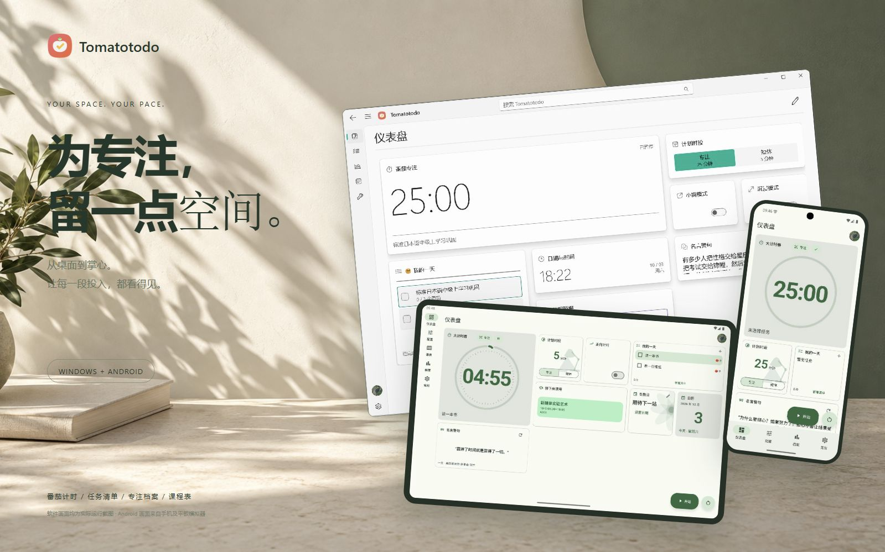
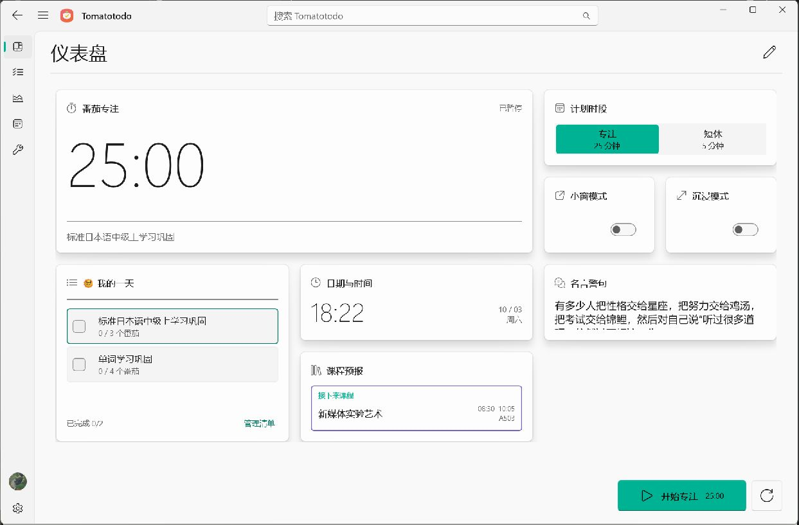
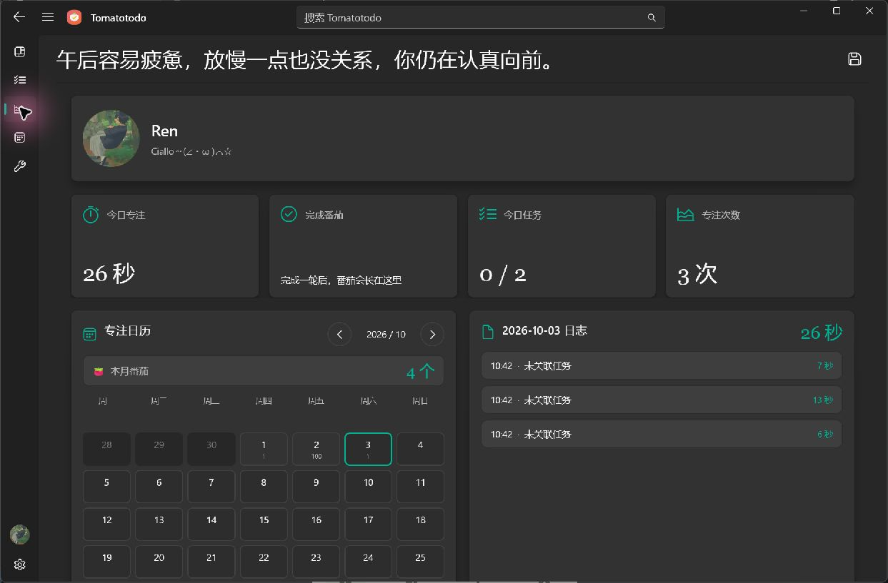
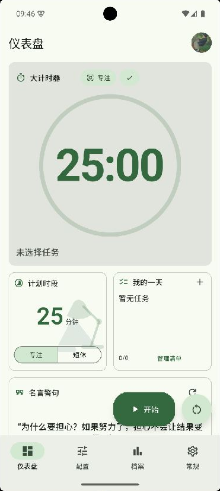
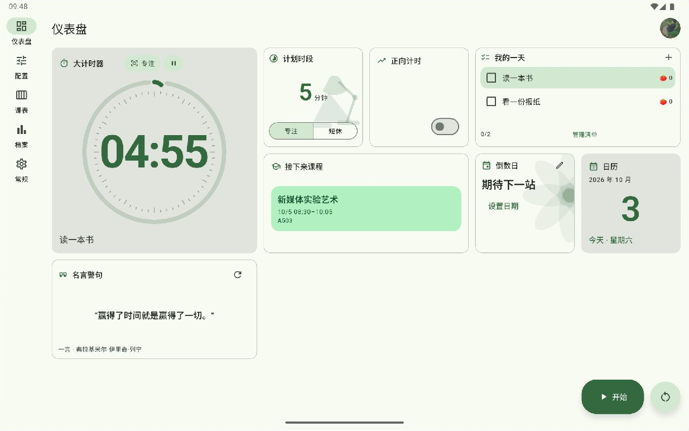
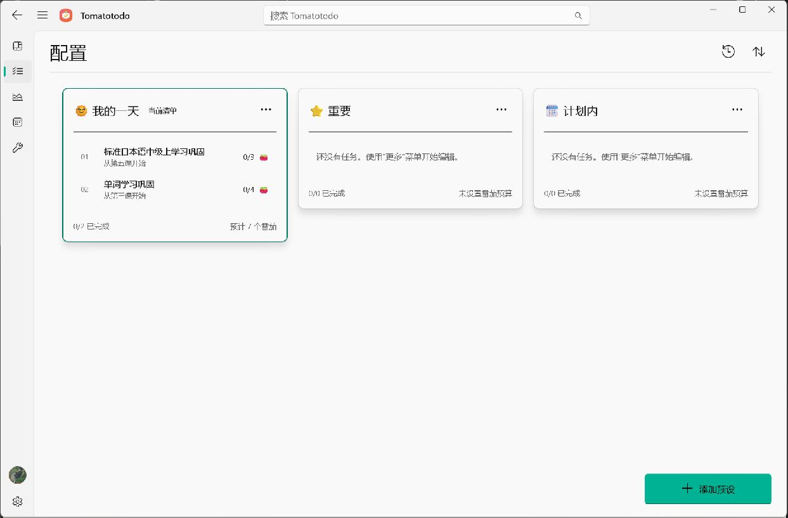
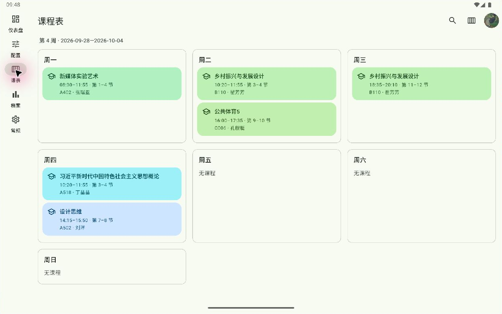
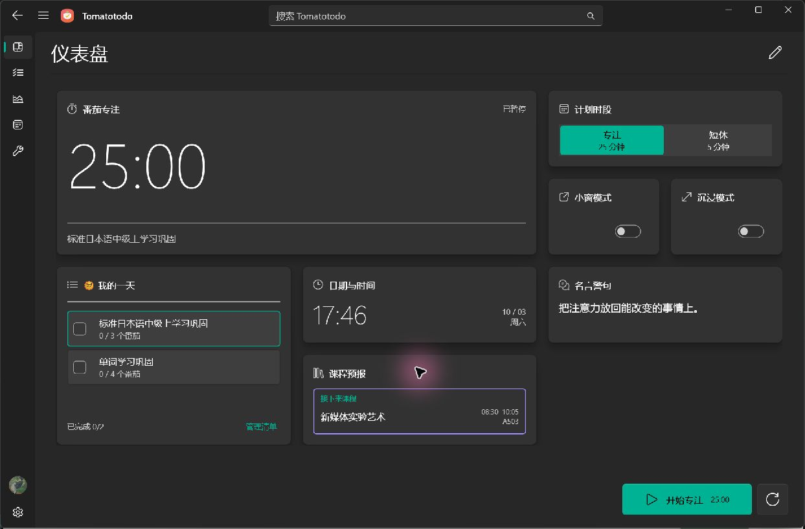
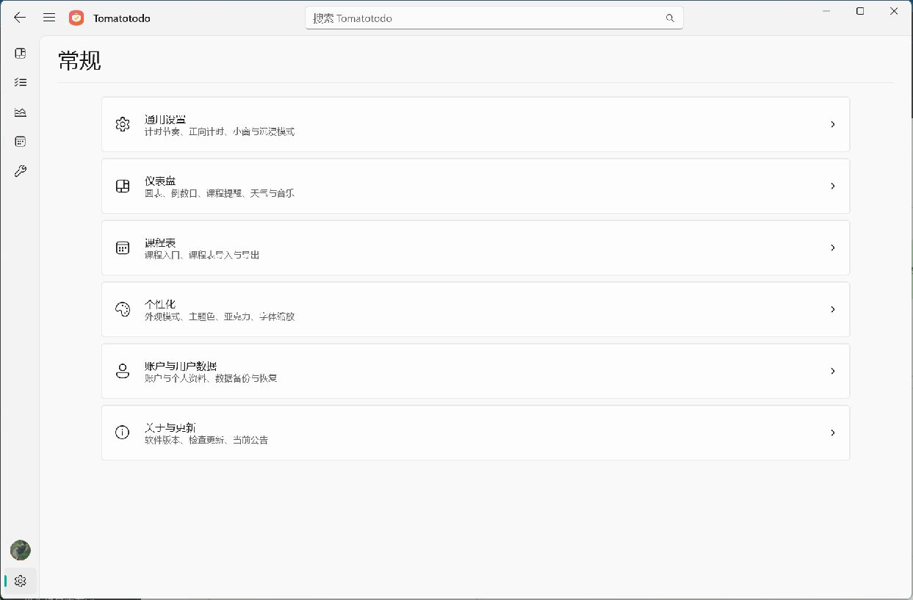

<p align="right">
  <a href="../README.md">EN</a> | <strong>CN</strong> | <a href="./README.ja.md">JA</a>
</p>

<div align="center">
  
  <h1>Tomatotodo</h1>
</div>

<p align="center">
  <em>适用于 Windows 与 Android 的番茄计时、任务清单与专注记录应用。</em>
</p>

<p align="center">
    <a href="https://github.com/GreentailTohru-arch/Tomatotodo/releases/download/v1.6.2/Tomatotodo-Setup-1.6.2.exe"></a>
    <a href="https://github.com/GreentailTohru-arch/Tomatotodo/releases/download/android-v1.0.3/Tomatotodo-1.0.3.apk"></a>
    <a href="../LICENSE"></a>
</p>

<div align="center">
  <a href="https://greentailtohru-arch.github.io/Tomatotodo/"></a>
</div>

## 什么是 Tomatotodo？

Tomatotodo 将任务安排、专注计时和时间记录放在同一个应用中。选择任务后即可开始计时，并在专注档案中回顾时间分配。Windows 与 Android 客户端均可独立使用，也可登录同一个云端账户。

## 支持的平台

| 平台 | 系统要求 | 版本说明 |
| --- | --- | --- |
| Windows | Windows 10 2004 或更新版本（含 Windows 11），x64 | [1.6.2](https://github.com/GreentailTohru-arch/Tomatotodo/releases/tag/v1.6.2) |
| Android | Android 7.0 或更新版本；arm64-v8a、armeabi-v7a、x86_64 | [1.0.3](https://github.com/GreentailTohru-arch/Tomatotodo/releases/tag/android-v1.0.3) |

## 界面展示

### Windows 桌面

<table>
  <tr>
    <td width="50%" align="center"><br><sub><b>Windows 仪表盘</b></sub></td>
    <td width="50%" align="center"><br><sub><b>Windows 专注档案</b></sub></td>
  </tr>
</table>

### Android 手机和平板

<table>
  <tr>
    <td width="30%" align="center"><br><sub><b>Android 手机仪表盘</b></sub></td>
    <td width="70%" align="center"><br><sub><b>Android 平板仪表盘</b></sub></td>
  </tr>
</table>

<details>
<summary>查看更多界面：清单、课表与外观</summary>

<table>
  <tr>
    <td width="50%" align="center"><br><sub><b>Windows 任务清单</b></sub></td>
    <td width="50%" align="center"><br><sub><b>Android 平板课程表</b></sub></td>
  </tr>
  <tr>
    <td width="50%" align="center"><br><sub><b>Windows 深色外观</b></sub></td>
    <td width="50%" align="center"><br><sub><b>Windows 常规设置</b></sub></td>
  </tr>
</table>

</details>

截图来自已安装的 Windows 客户端，以及在手机和平板模拟器中运行的 Android 客户端。

## 快速下载

- **Windows**: [下载 EXE](https://github.com/GreentailTohru-arch/Tomatotodo/releases/download/v1.6.2/Tomatotodo-Setup-1.6.2.exe)
- **Android**: [下载 APK](https://github.com/GreentailTohru-arch/Tomatotodo/releases/download/android-v1.0.3/Tomatotodo-1.0.3.apk)

## 主要功能

### 计时与任务

- 自定义专注与短休时长，支持手动循环、自动循环和从零开始的正向计时。
- 管理多份任务清单，调整任务顺序，设置预计番茄数并查看完成进度。

### 专注档案与课程表

- 查看每日日志、日／周／月／年统计和年度专注热力图。
- 按周查看课表，设置课前提醒，并独立导入或导出课表 JSON。

### 界面与组件

- 编排仪表盘组件，切换浅色、深色或自动外观，界面语言可跟随系统。
- Windows 提供计时小窗和系统托盘操作；Android 支持调整部分仪表盘卡片的大小，并提供桌面小组件。

## 安装

Windows 运行 EXE 并按向导完成安装；Android 打开 APK 并按系统提示安装。公开 APK 使用工程的调试证书签名。升级前建议导出 JSON 备份。

### 首次使用

1. 在「配置」创建清单并添加任务。
2. 在「仪表盘」选择任务并开始计时。可在「常规」调整专注与短休时长。
3. 在「档案」中查看本次专注记录。

## 多设备同步

两端登录同一个云端账户后，可同步任务清单、课程表、计时设置和专注日志。使用应用内的数据迁移功能可将本地数据转入云端。若两端同时修改同一数据分区，按应用提示处理冲突。 [跨平台同步协议](../windows/docs/cross-platform-sync-v2.md)

## 应用数据与隐私

核心功能无需登录。用户数据可导出为 JSON，用于备份或迁移。当前计时进度留在本机，仪表盘布局与外观按平台分别保存。云端服务端单独维护。

## 从源码构建

| 路径 | 内容 | 文档 |
| --- | --- | --- |
| [`windows/`](../windows/) | C# / .NET 10 / WinUI 3 客户端 | [Windows 开发说明](../windows/README.md) |
| [`android/`](../android/) | Flutter / Dart / Kotlin 客户端 | [Android 开发说明](../android/README.md) |
| [`Website/`](../Website/) | 静态官网和截图 | [官网部署说明](../Website/README.md) |
| [`docs/archive/`](./archive/) | 1.3.0 版历史鉴别材料 | — |

### Windows

准备 .NET 10 SDK、Windows SDK 与 Visual Studio WinUI 开发工具。

```powershell
cd windows
dotnet restore Tomatotodo.Windows.csproj
dotnet build Tomatotodo.Windows.csproj -p:Platform=x64
dotnet run --project tests/CourseSchedule.Tests.csproj
dotnet run --project tools/Sync.Tests/Sync.Tests.csproj
```

### Android

准备 Flutter、Android SDK 和 JDK 17。Dart 版本约束见 [`pubspec.yaml`](../android/pubspec.yaml)

```bash
cd android
flutter pub get
flutter analyze
flutter test
flutter build apk --release
```

## 反馈与贡献

[GitHub Issues](https://github.com/GreentailTohru-arch/Tomatotodo/issues) — 请通过 GitHub Issues 报告问题或提出建议，并提供平台、应用版本、复现步骤、预期结果和实际结果。提交日志或截图前，请移除个人信息。

## 开源许可证

[MIT](../LICENSE) · 本项目采用 MIT 许可证。
